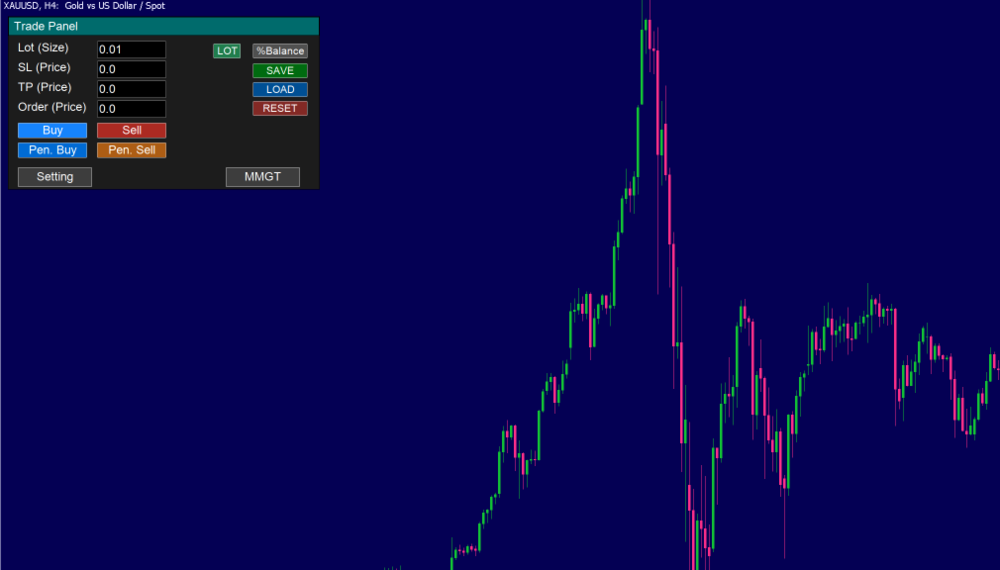
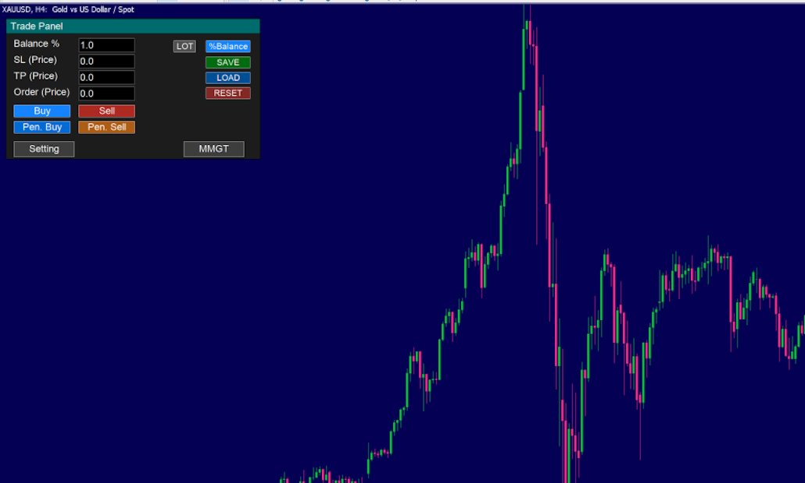
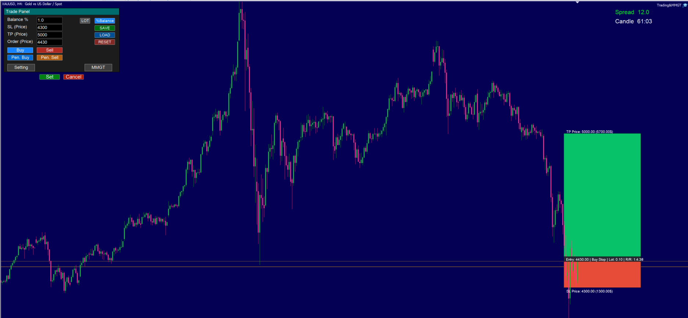

# MMGT Trade Manager EA

An on-chart trading panel for MetaTrader 5 for discretionary traders. It covers position sizing, risk management and trade execution from the chart.

## Features
- Fixed-lot or balance-percentage risk modes
- Stop-loss-based lot calculation
- Partial close, break-even, trailing stop
- Equity protection and daily loss lock

## Screenshots

## Files
- `MMGT.ex5`: compiled EA for MetaTrader 5 (no source code in this repo)

## Installation
1. Copy `MMGT.ex5` to `MQL5/Experts` in your MetaTrader 5 data folder.
2. Restart MetaTrader 5 or refresh the Navigator.
3. Drag the EA onto a chart and enable algorithmic trading.

Requires MetaTrader 5.

## Product page
https://www.mql5.com/en/market/product/173216
